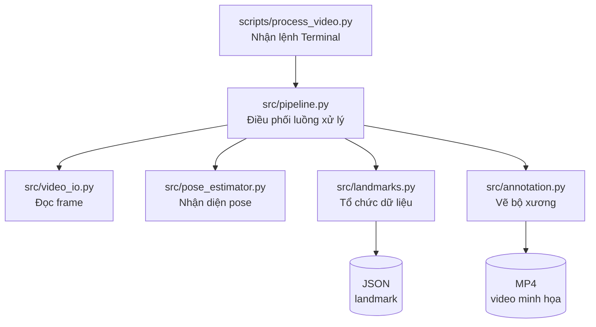

# Luồng chạy của dự án đến Phase 1

Tài liệu mô tả cấu trúc và luồng xử lý của pipeline nhận diện tư thế (pose) từ video, tính đến hết **Phase 1**. Đây là nền tảng cho Phase 2 (tính các chỉ số dáng chạy).

> **Lưu ý:** Sơ đồ bên dưới mô tả trách nhiệm tổng quát của từng file, không khẳng định thứ tự gọi hàm chính xác trong source code. Muốn xác nhận chi tiết, cần đọc nội dung từng file.

---

## 1. Tổng quan

Phase 1 nhận một video đầu vào, dùng mô hình **MediaPipe Pose Landmarker** để ước lượng tư thế cơ thể trên từng frame, sau đó xuất ra:

- **JSON**: dữ liệu landmark (các điểm cơ thể) đã được trích xuất.
- **MP4**: video minh họa có vẽ bộ xương (skeleton) lên trên video gốc.

## 2. Phase 0 – Thiết lập môi trường

- Hệ điều hành: Windows 11 x64.
- Python mục tiêu: **3.11** (không thay thế âm thầm bằng 3.12).
- Thư viện chính: `mediapipe`, `opencv-contrib-python`.
- Phase 0 chỉ giới hạn ở phần setup và tài liệu, chưa có logic xử lý video.

## 3. Chức năng của từng file `.py`

| # | File | Vai trò | Mô tả |
|---|------|---------|-------|
| 1 | `scripts/process_video.py` | **Điểm khởi chạy** | Nhận lệnh Terminal, đọc tham số (đường dẫn video, model, nơi lưu kết quả), rồi gọi pipeline xử lý. |
| 2 | `src/video_io.py` | Đọc và kiểm tra video | Mở file video, lấy thông tin video, đọc từng frame. |
| 3 | `src/pose_estimator.py` | Chạy mô hình MediaPipe | Khởi tạo Pose Landmarker và dùng mô hình để ước lượng tư thế cơ thể từ các frame. |
| 4 | `src/landmarks.py` | Tổ chức dữ liệu landmark | Xử lý dữ liệu các điểm cơ thể được nhận diện, chuẩn hóa cấu trúc dữ liệu, hỗ trợ tạo dữ liệu đầu ra. |
| 5 | `src/annotation.py` | Vẽ kết quả lên video | Dùng frame và landmark để vẽ các điểm, đường nối bộ xương, phục vụ tạo video MP4 minh họa. |
| 6 | `src/pipeline.py` | Kết nối các bước xử lý | Điều phối luồng: đọc video → nhận diện pose → thu thập dữ liệu → tạo kết quả đầu ra. |
| 7 | `src/__init__.py` | Đánh dấu package Python | Giúp Python coi `src` là một package. File này có thể không chứa logic xử lý video. |
| 8 | `tests/test_phase1_pipeline.py` | Kiểm thử tự động | Chứa các test kiểm tra hành vi của pipeline. Phục vụ kiểm thử, không tạo kết quả trong lần chạy video thông thường. |

## 4. Các file phối hợp với nhau như thế nào?



Dạng văn bản:

```
process_video.py   (nhận lệnh Terminal)
        │
        ▼
pipeline.py        (điều phối luồng xử lý)
        │
        ├── video_io.py        — đọc frame
        ├── pose_estimator.py  — nhận diện pose
        ├── landmarks.py       — tổ chức dữ liệu
        └── annotation.py      — vẽ bộ xương
        │
        ▼
   JSON   +   MP4
```

## 5. Đầu ra của Phase 1

| Đầu ra | Nội dung | Dùng để |
|--------|----------|---------|
| JSON | Tọa độ landmark của từng frame | Đầu vào quan trọng cho Phase 2 |
| MP4 | Video gốc có vẽ bộ xương | Kiểm tra trực quan kết quả nhận diện |

## 6. Chuẩn bị cho Phase 2

Không cần thuộc code, chỉ cần nắm ba ý:

1. `process_video.py` là **cửa vào**: lệnh Terminal gọi file này.
2. `pipeline.py` là **bộ điều phối**: các module trong `src/` đảm nhận các nhiệm vụ chuyên biệt.
3. **JSON là đầu vào quan trọng cho Phase 2**: thay vì nhận diện cơ thể từ đầu một lần nữa, Phase 2 có thể đọc landmark đã trích xuất để tính các chỉ số dáng chạy.

Ví dụ: Phase 2 có thể dùng tọa độ hông, gối và mắt cá chân trong JSON để tính góc gối theo thời gian. Đây là phần logic mới, chưa có trong pipeline Phase 1 hiện tại.

**Thứ tự đọc code đề xuất trước khi bắt đầu Phase 2:**

1. `src/pipeline.py` – để thấy rõ các module kết nối với nhau ra sao.
2. `src/landmarks.py` – để hiểu cấu trúc dữ liệu mà Phase 2 sẽ sử dụng.
