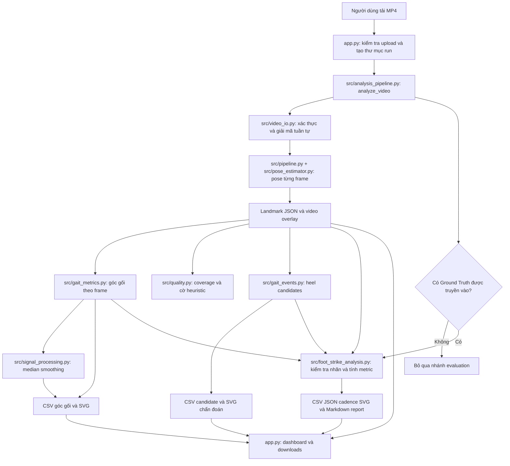

# Running Gait Analysis

Ứng dụng Streamlit phân tích hậu kỳ video chạy bộ quay ngang. Video được xử lý cục bộ bằng MediaPipe Pose Landmarker; ứng dụng tính góc gối 2D, tạo candidate sự kiện từ quỹ đạo gót chân và hiển thị kết quả. Nếu có Ground Truth phù hợp với video, hệ thống đánh giá candidate, tính góc gối tại event đã gán nhãn và cadence từ nhãn.

> Đây là dự án học tập/quan sát chuyển động, không phải huấn luyện viên realtime, thiết bị đo tiếp xúc hay công cụ chẩn đoán y tế. Video đơn camera 2D chịu ảnh hưởng của góc quay, phối cảnh, che khuất, ánh sáng, FPS và sai số landmark.

## Chức năng hiện có

- Upload video MP4, kiểm tra khả năng giải mã; giới hạn mặc định của ứng dụng là 100 MiB và 60 giây.
- Trích xuất pose theo frame bằng MediaPipe Pose Landmarker chạy CPU; lưu metadata, timestamp và 33 landmark.
- Tạo video overlay skeleton, CSV góc gối theo frame, CSV góc đã làm mượt và biểu đồ SVG.
- Tạo candidate `heel_vertical_low_point_candidate` từ cực đại cục bộ của tọa độ ảnh-y gót chân. Đây là heuristic thử nghiệm, không xác nhận tiếp đất.
- Khi có Ground Truth cho đúng video, đối chiếu hai thuật toán với nhãn, xuất event metrics, góc gối ở frame Ground Truth và cadence dựa trên nhãn.
- Hiển thị video, biểu đồ, coverage, quỹ đạo cổ chân và cho tải artifacts từ dashboard.

Các bước phân tích chạy hậu kỳ sau khi người dùng chọn **Analyze video**; không có phân tích realtime. Visibility/presence là tín hiệu từ model pose, không phải độ chính xác sinh cơ học.

## Kiến trúc và luồng xử lý



1. `app.py` ghi upload vào file tạm, tạo thư mục kết quả mới dưới `outputs/streamlit_runs/` và gọi pipeline. File tạm được dọn sau khi phân tích.
2. `src/analysis_pipeline.py` điều phối xác thực video, pose extraction, góc gối, quality diagnostics, smoothing, candidate detection và ghi artifacts.
3. `src/video_io.py` kiểm tra metadata và giải mã frame. `src/pipeline.py` xử lý từng frame; `src/pose_estimator.py` bao MediaPipe Tasks Pose Landmarker cục bộ. Timestamp hiện được tính từ `frame_index / fps` khi FPS hợp lệ.
4. `src/gait_metrics.py` tính góc hình học 2D tại gối từ hip-knee-ankle. `src/signal_processing.py` làm mượt median 5 mẫu trên từng đoạn hợp lệ và giữ nguyên khoảng thiếu. `src/quality.py` thống kê coverage và gắn cờ biến thiên lớn liên tiếp theo Tukey; cờ chỉ gợi ý xem lại.
5. `src/gait_events.py` lấy heel của pose đầu tiên, lọc mẫu thiếu/confidence thấp, làm mượt median 5 frame và tìm cực đại cục bộ trên trục y ảnh (y tăng xuống dưới). Kết quả là candidate điểm thấp của gót, không phải contact đã xác nhận.
6. Nhánh Ground Truth chỉ chạy nếu caller truyền CSV. Pipeline kiểm tra tên video và metadata nguồn, sau đó `src/foot_strike_analysis.py` đọc nhãn, tạo hai bộ predictions, matching và tính metrics. Module không tự gán nhãn.
7. Dashboard hiển thị kết quả và cho tải artifacts. H.264 playback được tạo từ overlay nếu bộ chuyển mã khả dụng; MP4V gốc vẫn được giữ.

## Cấu trúc thư mục và trách nhiệm module

```text
.
├── app.py
├── requirements.txt
├── outputs/                       # Kết quả và dữ liệu local; bị .gitignore loại khỏi Git
├── scripts/
│   ├── process_video.py           # CLI Phase 1
│   ├── evaluate_ground_truth.py   # Evaluation từ landmarks đã lưu
│   ├── prepare_event_review.py    # Worksheet/contact sheet xem candidate
│   └── validate_event_review.py   # Kiểm tra nhãn review
├── src/
│   ├── analysis_pipeline.py       # Điều phối phân tích và artifacts
│   ├── pipeline.py                # Trích xuất landmark theo frame
│   ├── video_io.py                # Đọc video, metadata, decode
│   ├── pose_estimator.py           # Adapter MediaPipe Pose Landmarker
│   ├── landmarks.py                # Schema, JSON, góc hình học
│   ├── gait_metrics.py             # Góc gối theo frame
│   ├── quality.py                  # Coverage và cờ heuristic
│   ├── signal_processing.py        # Median smoothing
│   ├── gait_events.py              # Candidate từ quỹ đạo gót
│   ├── foot_strike_analysis.py     # Ground Truth, matching, metrics
│   ├── manual_review.py             # Worksheet và contact sheet
│   ├── visualization.py            # SVG và playback quỹ đạo cổ chân
│   ├── annotation.py                # Ghi overlay skeleton
│   ├── video_transcoding.py         # Chuyển overlay sang H.264 nếu khả dụng
│   └── report.py                   # Ghi CSV góc và events
├── tests/                          # unittest offline với fixtures/mocks
└── docs/                           # Setup, pipeline và phương pháp đánh giá
```

| Module | Trách nhiệm | Đầu vào | Đầu ra/phối hợp |
|---|---|---|---|
| `app.py` | Upload, điều phối UI, hiển thị và downloads | Video, cấu hình model | Gọi `analyze_video`, hiển thị artifacts trong run mới |
| `src/analysis_pipeline.py` | Điều phối các bước và bảo vệ output không ghi đè | Video, model, tùy chọn Ground Truth | Gọi modules phân tích; trả `AnalysisResult` |
| `src/video_io.py` | Kiểm tra MP4, metadata và đọc frame | Đường dẫn video | `VideoMetadata`, frame đã decode |
| `src/pipeline.py`, `src/pose_estimator.py` | Inference pose theo frame | Frame BGR, model `.task` | Landmark JSON và tùy chọn overlay |
| `src/landmarks.py` | Schema 33 landmark, serialize, `angle_2d_degrees` | Pose/model output | JSON có cấu trúc và phép tính góc |
| `src/gait_metrics.py` | Tính góc gối hai bên cho từng frame | Landmark JSON, confidence thresholds | Góc và status theo frame |
| `src/quality.py`, `src/signal_processing.py` | Chẩn đoán coverage; smoothing theo đoạn liên tục | Dữ liệu góc | Quality flags và cột góc smoothed |
| `src/gait_events.py` | Phát hiện heel-trajectory candidates | Landmark JSON, tham số detector | `CandidateEvent` và tín hiệu để ghi CSV/plot |
| `src/foot_strike_analysis.py` | Đọc/kiểm tra nhãn, matching và tính thống kê | Ground Truth, landmarks, predictions | Evaluation, match, góc tại event, cadence, report |
| `src/visualization.py` | Tạo biểu đồ và ankle playback | Landmark JSON, metric/event rows | SVG/HTML cho dashboard |
| `src/report.py`, `src/annotation.py`, `src/video_transcoding.py` | Xuất bảng, overlay và chuyển mã | Dữ liệu pipeline/frame | CSV, MP4 overlay, H.264 tùy môi trường |
| `src/manual_review.py` | Tạo worksheet và context sheet để người xem xét | Candidate CSV, video, review CSV | File review; không tự tạo nhãn |
| `scripts/evaluate_ground_truth.py` | Chạy evaluation độc lập không inference | Landmark JSON, Ground Truth CSV, output mới | CSV/JSON/SVG/Markdown report |

`outputs/` chứa video, nhãn và kết quả phân tích local. Theo `.gitignore`, toàn bộ thư mục này, `data/local/`, video trong `data/samples/` và model `.task`/`.tflite` không được theo dõi bởi Git. Không đưa video cá nhân, model weights hoặc output lớn lên Git nếu chưa có quyết định rõ.

## Phương pháp phân tích

### Landmarks, góc gối và smoothing

MediaPipe cung cấp 33 landmark cho mỗi pose. `x`/`y` chuẩn hóa theo ảnh; `z` là tọa độ tương đối của model, không phải độ sâu tính bằng mét. Visibility/presence được lưu nếu API có; đây là tín hiệu chất lượng của model, không phải xác suất chính xác.

Góc gối là góc hình học 2D tại knee giữa vector hip-knee và ankle-knee, tính từ tọa độ đã đổi sang pixel. Góc gần 180° biểu thị hai đoạn gần thẳng hàng. Landmark thiếu, confidence dưới ngưỡng hoặc hình học suy biến tạo góc trống với status tương ứng. Median smoothing dùng cửa sổ 5 mẫu riêng trên mỗi đoạn liên tục hợp lệ; khoảng thiếu không được nội suy.

### Candidate foot-strike

Algorithm A (`heel_trajectory_local_extrema`) lọc heel theo visibility/presence ≥ 0.5, đổi y sang pixel theo chiều cao ảnh và median smoothing 5 frame. Detector tìm cực đại cục bộ y với prominence tối thiểu 20 px trong vùng lân cận 30 frame. Candidate cùng bên cách nhau dưới 12 frame được gộp, giữ candidate prominence cao hơn. Event được ghi rõ là `heel_vertical_low_point_candidate` cùng cờ `exploratory_unvalidated`.

Algorithm B (`foot_contact_zone`) chỉ chạy trong evaluation. Nó dùng y thấp hơn giữa heel và foot-index, vùng belt-height heuristic, giới hạn tốc độ dọc và khoảng cách tối thiểu. Ngưỡng belt phụ thuộc camera/treadmill. Hai thuật toán dùng cùng landmarks từ cùng video/model; B không phải sensor độc lập.

Prediction candidate khác Ground Truth: candidate là kết quả heuristic cần đánh giá, còn Ground Truth là nhãn tham chiếu do người annotator ghi. Hệ thống không đo contact time chính xác từ keypoint cổ chân.

### Ground Truth, matching và cadence

Nhãn hiện có tại `outputs/foot_strike_ground_truth.csv` cho `running_gait_sideview.mp4`: 31 event từ frame 27 đến 318; clip có 321 frame, 720 × 878, 30 FPS, dài 10,7 giây. Quy ước nhãn là frame đầu tiên quan sát được giày chạm băng chạy. `label_confidence` và `notes` để trống theo dữ liệu nguồn, không được phần mềm tự suy diễn.

Pipeline kiểm tra tên video, frame/timestamp và metadata nguồn. CLI có thể kiểm tra fingerprint nếu nhận `--source-video`. Matching tách theo bên, một-một; tối đa số cặp hợp lệ trong tolerance ±2 frames rồi giảm tổng sai số tuyệt đối. Signed error là prediction trừ Ground Truth. Metrics gồm TP, FP, FN, Precision, Recall, F1, mean signed timing error và mean absolute timing error theo frame/ms.

Góc gối tại event được tính trên hip-knee-ankle ở frame Ground Truth, với ngưỡng confidence 0.5; dữ liệu không hợp lệ để góc trống. Cadence đếm mỗi event Ground Truth là một bước, chia tổng số event cho toàn bộ thời lượng clip rồi nhân 60. Cadence series dùng cửa sổ 2 giây, bước 0,5 giây. Clip dưới 3 giây hoặc có dưới 4 event không xuất cadence trung bình.

Kết quả đã ghi cho clip này: Algorithm A F1 = 0,867 (trái), 0,933 (phải); Algorithm B F1 = 0,625 (trái), 0,000 (phải). Đây là số liệu mô tả trên **một video**, với nhãn quan sát bằng video; không phải độ chính xác tổng quát hoặc phép đo lực tiếp xúc. Xem thêm [báo cáo Phase 3](docs/PHASE3_GROUND_TRUTH_EVALUATION.md).

## Cài đặt và chạy

Môi trường mục tiêu trong tài liệu là Windows x64/Python 3.11; dependencies trực tiếp được pin trong `requirements.txt`. Phase 0 trước đó ghi nhận dependency và khởi tạo model thành công trên Python 3.12.10; Python 3.11 runtime vẫn cần xác minh riêng. Xem [hướng dẫn Phase 0](docs/PHASE0_SETUP.md) để tải model và kiểm tra checksum.

PowerShell tại thư mục gốc:

```powershell
py -3.11 -m venv .venv
.\.venv\Scripts\Activate.ps1
python -m pip install --upgrade pip
python -m pip install -r requirements.txt
```

Tải Pose Landmarker Full float16 v1 theo tài liệu Phase 0 vào `models/pose_landmarker_full.task`, rồi chạy UI:

```powershell
streamlit run app.py
```

Ứng dụng xử lý cục bộ, mặc định tối đa 100 MiB/60 giây. Mỗi lần chạy tạo thư mục mới trong `outputs/streamlit_runs/`. Ground Truth tự được chọn chỉ khi tên upload là `running_gait_sideview.mp4` và CSV có tại `outputs/foot_strike_ground_truth.csv`; pipeline vẫn xác minh dữ liệu nguồn.

### CLI Phase 1

```powershell
python scripts/process_video.py "path/to/run.mp4" `
  --model "models/pose_landmarker_full.task" `
  --output "outputs/run_landmarks.json" `
  --annotated-video "outputs/run_annotated.mp4"
```

Bỏ `--annotated-video` nếu không cần overlay. `--max-bytes 0` và `--max-seconds 0` tắt giới hạn tương ứng. CLI Phase 1 chỉ trích xuất pose, không chạy gait event/metric.

### Kiểm thử

```powershell
python -m unittest discover -s tests -v
```

Tests dùng fixtures/mocks và chạy offline, không tải model hoặc cần Internet. Các nhóm gồm góc, xử lý tín hiệu, quality, event detection, Ground Truth analysis, pipeline, video I/O/transcoding, manual review và app. Hãy chạy lại lệnh trên để xác nhận trạng thái trong môi trường của bạn; không mặc định test luôn pass.

### Đánh giá Ground Truth từ dữ liệu đã lưu

Lệnh này không chạy lại MediaPipe. Chọn output directory mới; script từ chối nếu thư mục đó đã tồn tại:

```powershell
python scripts/evaluate_ground_truth.py `
  outputs/running_gait_sideview_landmarks.json `
  outputs/foot_strike_ground_truth.csv `
  outputs/running_gait_sideview_ground_truth_eval_new `
  --source-video "path/to/running_gait_sideview.mp4"
```

Input Ground Truth phải khớp chính xác video và landmark timeline. Không dùng nhãn clip mẫu cho video khác.

## Artifacts

Mỗi lượt `analyze_video` tạo thư mục mới, không ghi đè output directory đã tồn tại. Tên file dùng stem video:

| Artifact | Nội dung |
|---|---|
| `<video>_landmarks.json` | Metadata, timestamp và landmarks từng frame |
| `<video>_annotated.mp4` | Video skeleton overlay MP4V |
| `<video>_knee_angles_phase22.csv` | Góc gối và status theo frame |
| `<video>_knee_angles_phase23.csv` | Góc gối kèm cột smoothed |
| `<video>_knee_angles_phase23.svg` | Biểu đồ góc gối |
| `<video>_gait_events_phase24.csv` | Candidate heel events và tín hiệu liên quan |
| `<video>_gait_events_phase24.svg` | Biểu đồ tín hiệu candidate |
| `foot_strike_evaluation_summary.csv`, `foot_strike_evaluation_matches.csv`, `foot_strike_evaluation.json` | Chỉ khi có Ground Truth: metric và ghép event |
| `knee_angles_at_ground_truth.csv`, `cadence.csv`, `cadence.svg` | Chỉ khi có Ground Truth: góc tại nhãn và cadence |
| `ground_truth_metrics_summary.json`, `ground_truth_evaluation_report.md` | Chỉ khi có Ground Truth: tổng hợp và report |

Dashboard có thể tạo thêm bản H.264 để phát trong browser nếu chuyển mã khả dụng; overlay MP4V gốc vẫn được giữ để tải.

## Giới hạn và hướng phát triển

- Ground Truth hiện là quan sát video của một clip, không phải force plate hoặc cảm biến tiếp xúc đồng bộ. Một clip không xác lập hiệu năng tổng quát.
- Góc nhìn đơn camera không cho phép đo 3D; che khuất và sai số pose ảnh hưởng event và góc.
- Foot-strike detector là heuristic trên landmarks, chưa được xác thực rộng trên nhiều runner/video. Contact time không được suy ra chính xác từ cổ chân.
- Góc gối là ước lượng hình học 2D. Cadence trong nhánh Ground Truth lấy từ event nhãn, không lấy từ heel candidates.
- Hướng phát triển phù hợp: mở rộng video được annotate độc lập, ghi quy tắc và độ đồng thuận người gán nhãn, đánh giá trên người/video riêng biệt rồi mới điều chỉnh detector.

Tài liệu liên quan: [PROJECT_SPEC.md](PROJECT_SPEC.md), [ARCHITECTURE.md](ARCHITECTURE.md), [PLAN.md](PLAN.md), [EVALUATION.md](EVALUATION.md), [docs/](docs/).
